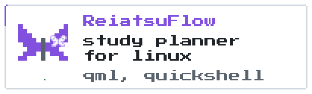
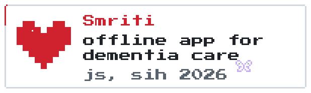
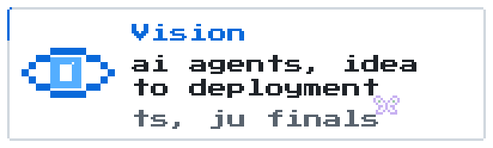
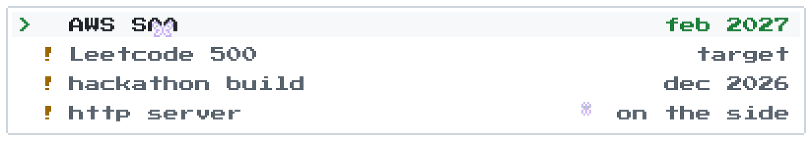
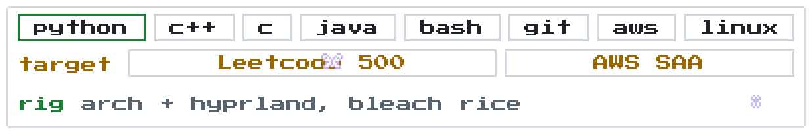

<picture><source media="(prefers-color-scheme: dark)" srcset="https://raw.githubusercontent.com/J-J22/J-J22/main/banner-dark.gif"></picture>

Hey, I'm Jai, I go by JoC here. Second year CSE at JECRC in Jaipur, Learning Cloud Computing, Making Projects hackathons all at once so yeah... busy

<picture><source media="(prefers-color-scheme: dark)" srcset="https://raw.githubusercontent.com/J-J22/J-J22/main/assets/h-projects-dark.gif"></picture>

<a href="https://github.com/J-J22/reiatsuflow"><picture><source media="(prefers-color-scheme: dark)" srcset="https://raw.githubusercontent.com/J-J22/J-J22/main/assets/card-reiatsuflow-dark.gif"></picture></a><a href="https://github.com/J-J22/smriti"><picture><source media="(prefers-color-scheme: dark)" srcset="https://raw.githubusercontent.com/J-J22/J-J22/main/assets/card-smriti-dark.gif"></picture></a><a href="https://github.com/J-J22/Vision"><picture><source media="(prefers-color-scheme: dark)" srcset="https://raw.githubusercontent.com/J-J22/J-J22/main/assets/card-vision-dark.gif"></picture></a><a href="https://j-j22.github.io"><picture><source media="(prefers-color-scheme: dark)" srcset="https://raw.githubusercontent.com/J-J22/J-J22/main/assets/card-portfolio-dark.gif"></picture></a>

<picture><source media="(prefers-color-scheme: dark)" srcset="https://raw.githubusercontent.com/J-J22/J-J22/main/assets/h-quest-log-dark.gif"></picture>

<picture><source media="(prefers-color-scheme: dark)" srcset="https://raw.githubusercontent.com/J-J22/J-J22/main/assets/quests-dark.gif"></picture>

<picture><source media="(prefers-color-scheme: dark)" srcset="https://raw.githubusercontent.com/J-J22/J-J22/main/assets/h-inventory-dark.gif"></picture>

<picture><source media="(prefers-color-scheme: dark)" srcset="https://raw.githubusercontent.com/J-J22/J-J22/main/assets/inventory-dark.gif"></picture>

<picture><source media="(prefers-color-scheme: dark)" srcset="https://raw.githubusercontent.com/J-J22/J-J22/main/assets/h-contributions-dark.gif"></picture>

<picture><source media="(prefers-color-scheme: dark)" srcset="https://raw.githubusercontent.com/J-J22/J-J22/output/github-snake-dark.svg"></picture>

<picture><source media="(prefers-color-scheme: dark)" srcset="https://raw.githubusercontent.com/J-J22/J-J22/main/assets/h-find-me-dark.gif"></picture>

<a href="https://www.linkedin.com/in/joc22/"><picture><source media="(prefers-color-scheme: dark)" srcset="https://raw.githubusercontent.com/J-J22/J-J22/main/assets/btn-linkedin-dark.gif"></picture></a><a href="https://j-j22.github.io"><picture><source media="(prefers-color-scheme: dark)" srcset="https://raw.githubusercontent.com/J-J22/J-J22/main/assets/btn-portfolio-dark.gif"></picture></a><a href="mailto:jaiwardhanjoshi@gmail.com"><picture><source media="(prefers-color-scheme: dark)" srcset="https://raw.githubusercontent.com/J-J22/J-J22/main/assets/btn-email-dark.gif"></picture></a>
