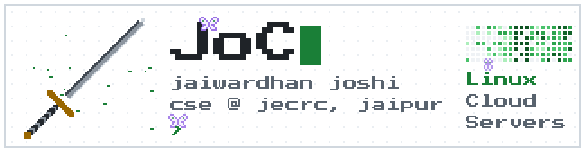

<picture>
  <source media="(prefers-color-scheme: dark)" srcset="https://raw.githubusercontent.com/J-J22/J-J22/main/banner-dark.gif">
  
</picture>

Hey, I'm Jai, I go by JoC here

Second year cse at jecrc in Jaipur. Right now I'm doing aws (going for the solutions architect cert), dsa in c++, college stuff and a hackathon all at once so yeah… busy

### Stuff I made

**[ReiatsuFlow](https://github.com/J-J22/reiatsuflow)** my study planner for linux, it turns my lists into a few tasks a day so I don't quit after 3 days lol 
**[Smriti](https://github.com/J-J22/smriti)** an offline app for elders with dementia in north east india, built it for an sih problem statement 
**[Vision](https://github.com/J-J22/Vision)** a team of ai agents that takes an app idea all the way to deployment, got to the finals at ju techfest 
**[Portfolio](https://github.com/J-J22/J-J22.github.io)** my site, pixel art and bleach themed obviously, it's up at [j-j22.github.io](https://j-j22.github.io)

### What I'm on right now

Aws saa is the big one, I'm aiming to sit it in feb 2027 so it's a bit every day till then. Dsa is the gfg sheet in c++, slow but I'm getting there ig

I'm also building something for a hackathon in december, it helps creators keep track of their deals and actually get paid. Repo's private till the hackathon's over

And on the side I'm doing the codecrafters http server in c++, first time I actually get what a server does with a request lol

### My setup

Arch with hyprland and the whole thing is bleach themed. The wallpaper cycles through characters and my planner changes colour with it… I spend way too much time on this

### Things I use

Python, c++, c, java, bash, linux (arch + hyprland), git and aws. Learning typescript, node, sql and docker right now

### My contributions getting eaten

<picture>
  <source media="(prefers-color-scheme: dark)" srcset="https://raw.githubusercontent.com/J-J22/J-J22/output/github-snake-dark.svg">
  
</picture>

### Find me

[LinkedIn](https://www.linkedin.com/in/joc22/) · [portfolio](https://j-j22.github.io) · jaiwardhanjoshi@gmail.com
